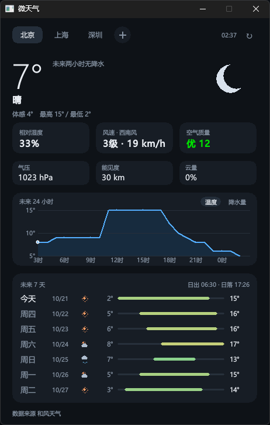

# 微天气 · MiniWeather

一个极简的 Windows 桌面天气应用，纯 Win32 API + GDI 绘制。

目标是内存占用尽可能低。实测内存占用低于 10 MB。



## 构建

需要 Visual Studio 2022（含 C++ 生成工具）与 Windows 10 SDK。

```bat
build.bat
build\weather.exe
```

`build.bat` 会自己定位 cl.exe 与 SDK 的 include/lib 目录。若要换路径，改脚本顶部的 `VSDIR` / `KITS` 两个变量即可。

## 目录结构

```
src/app.h     共享类型、主题配色、全局状态、接口声明
src/main.c    窗口、消息循环、常用城市管理、后台任务调度、命令行参数
src/ui.c      全部界面绘制与标签栏布局（GDI，双缓冲）
src/api.c     数据源分发、Open-Meteo 请求与解析、WMO 天气码中文文案
src/qweather.c 和风天气接入（GeoAPI / now / 24h / 7d）
src/net.c     WinHTTP 封装（含 gzip 响应自动解码）
src/gunzip.c  自写的 gzip/deflate 解压（无第三方依赖）
src/json.c    极简 JSON 解析器（直接解码为 UTF-16）
src/store.c   常用城市与 API 配置的注册表读写、旧配置迁移
src/util.c    UTF-8 转换、日期与字符串工具
tests/        JSON / gzip 自检用例 + 真实响应样本
tools/        截图与交互测试小工具
```

## 数据源

默认走 [Open-Meteo](https://open-meteo.com/)：免注册、免 Key、非商用免费，但地理编码只到地级市。
配上和风天气后自动切换，中国区精度与区县覆盖都更好（详见[docs/weather-api-survey.md](docs/weather-api-survey.md)）。

### 启用和风天气

在和风控制台拿到 **API Host**（形如 `xxxxx.re.qweatherapi.com`）和 **API Key**，然后：

```bat
build\weather.exe --host xxxxx.re.qweatherapi.com --key 你的Key
```

参数会写入注册表后立即生效，之后直接双击 `weather.exe` 即可。清除配置回到 Open-Meteo：

```bat
build\weather.exe --reset-api
```

配置保存在注册表（与城市列表同处）：

```
HKEY_CURRENT_USER\Software\MiniWeather
  Cities = REG_MULTI_SZ  '北京|39.9042|116.4074' ...
  Active = REG_SZ        '北京'
  QwHost = REG_SZ        'xxxxx.re.qweatherapi.com'
  QwKey  = REG_SZ        '...'
```
